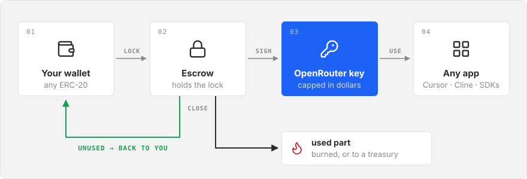
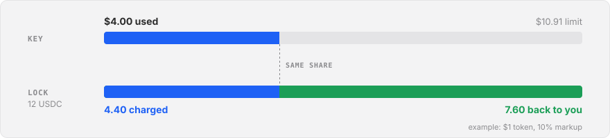
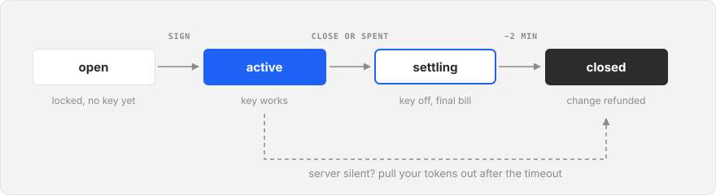
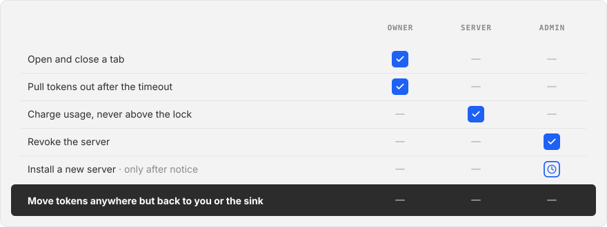
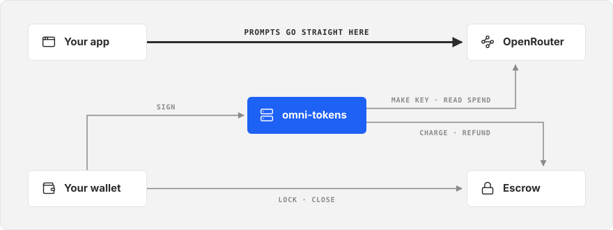

<div align="center">

# omni-tokens

### From ledger to language.

*Lock any coin. Get an OpenRouter key. What you don't spend comes home.*



</div>

## Try it

```sh
git clone --recurse-submodules https://github.com/whytrade/omni-tokens && cd omni-tokens
npm install && forge build && npm run dev
```

Open **localhost:8787** → connect → open a tab → paste the key into any app.

## Pay for what you use



## A tab's life



## Nobody can run off with it



## Prompts skip the server



## Run your own

1. **Deploy** · `SINK=burn ACCEPT_TOKENS=0x… npm run deploy`
2. **Fund** · OpenRouter credit + a provisioning key
3. **Configure** · `cp .env.example .env`
4. **Start** · `npm start`, or build the `Dockerfile`

<details>
<summary><b>Pricing tokens</b></summary>

```json
[
  { "address": "0xUSDC", "price": "1" },
  { "address": "0xWETH", "price": { "chainlink": "0xEthUsdFeed" } },
  { "address": "0xMEME", "price": { "uniswapV3": "0xMemeWethPool", "quote": { "chainlink": "0xEthUsdFeed" } },
    "floor": "0.00001", "ceiling": "0.01" }
]
```

- Fixed price, a Chainlink feed, or a 30-minute Uniswap v3 average times the other token's price.
- Pool-priced tokens need a USD `floor` and `ceiling`. Outside them, no keys are issued.
- The price is frozen when a key is issued.

</details>

<details>
<summary><b>Fine print</b></summary>

- **Not audited.** Read `contracts/TabEscrow.sol` and its tests first.
- **Operator risk:** keys can overshoot their limit with parallel requests, and usage after the last on-chain charge is lost on a force-release. Use a small markup and a credit buffer.
- **Price risk** sits with the operator, from claim until they sell. Burn mode never sells.
- **Tokens:** fee-on-transfer refused; rebasing unsupported; tokens whose smallest unit is worth more than a cent refused.
- **One server per database.**
- **New operators** wait twice the close timeout; revoking is instant.

</details>

<details>
<summary><b>For agents</b></summary>

[`skill/SKILL.md`](skill/SKILL.md): use a tab key, or open and close tabs inside a budget with `node cli/tab.ts`.

</details>

<details>
<summary><b>What's inside</b></summary>

```
contracts/TabEscrow.sol   escrow
src/                      server
cli/tab.ts                command line
web/index.html            web page
skill/SKILL.md            agent skill
scripts/                  deploy · local stack · mock OpenRouter
docs/                     diagrams
```

Test: `forge test` · `npm test` · `npm run check`

</details>

MIT
